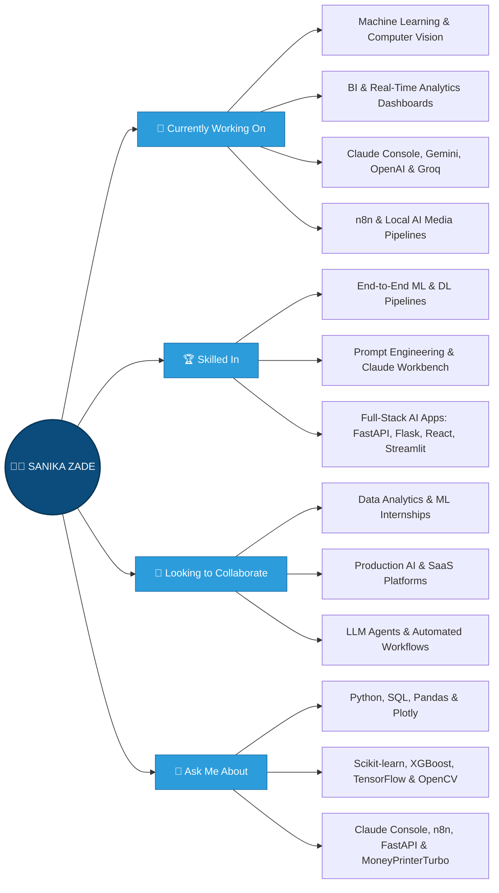

<h1 align="center">Hi 👋, I'm Sanika Zade</h1>

<h3 align="center">
Final-year B.Tech AI/ML student · Data Analytics Enthusiast · Aspiring ML Engineer
</h3>

  

  
  
  
  

---

I enjoy applying data analytics, machine learning, and generative AI to messy, real-world problems — the harder the dataset, the more interesting the story it tells.

---
## 🧠 AI Engineering, ML & Full-Stack Ecosystem

**🤖 Generative AI, Notebooks & Workflow Automation**

  
  
  
  
  
  
  
  
  

**⚙️ IDEs, DevOps & Environment Management**

  

**🌐 Full-Stack Web & App Deployment**

  

**🎨 Collaboration & Design**

  
  

---

## 📊 GitHub Stats

  

  

  
  &nbsp;
  

  

---

## 🌐 Connect with Me

  &nbsp;&nbsp;
  &nbsp;&nbsp;
  &nbsp;&nbsp;
  &nbsp;&nbsp;
  

---

## ⚡ Fun Fact

I enjoy applying data analytics and machine learning to messy, real-world problems — the harder the dataset, the more interesting the story it tells.
