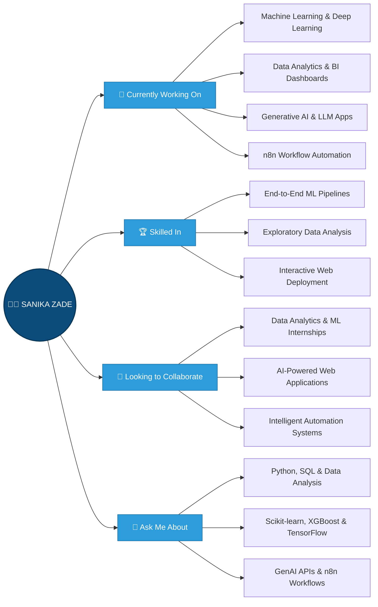

&lt;!-- Header Section --&gt;
&lt;div align=&quot;center&quot;&gt;

&lt;h1 align=&quot;center&quot;&gt;
  &lt;img src=&quot;https://media.giphy.com/media/hvRJCLFzcasrR4ia7z/giphy.gif&quot; width=&quot;30px&quot; alt=&quot;Wave&quot; /&gt;
  Hi there! I&#39;m Sanika Zade
&lt;/h1&gt;

&lt;p align=&quot;center&quot;&gt;
  &lt;img src=&quot;https://readme-typing-svg.demolab.com?font=Fira+Code&amp;weight=600&amp;size=24&amp;pause=1200&amp;color=00D4FF&amp;center=true&amp;vCenter=true&amp;width=650&amp;lines=Data+Analytics+Enthusiast;Aspiring+Machine+Learning+Engineer;Building+Real-World+AI+Projects;Open+to+Internships&quot; alt=&quot;Typing SVG&quot; /&gt;
&lt;/p&gt;

&lt;h3 align=&quot;center&quot;&gt;
  FINAL-YEAR B.TECH AI/ML STUDENT · DATA ANALYTICS ENTHUSIAST · ASPIRING ML ENGINEER
&lt;/h3&gt;

&lt;p align=&quot;center&quot;&gt;
  &lt;img src=&quot;https://media.licdn.com/dms/image/v2/D5612AQHmbpYRanwhfQ/article-cover_image-shrink_720_1280/article-cover_image-shrink_720_1280/0/1735300309639?e=2147483647&amp;v=beta&amp;t=0FkHA6D6JoE5n5-TN487s5WIvc15d29IDfUcYdXnCk0&quot; alt=&quot;Welcome Header Image&quot; width=&quot;100%&quot; /&gt;
&lt;/p&gt;

&lt;p align=&quot;center&quot;&gt;
  &lt;img src=&quot;https://img.shields.io/badge/Open_to-Internships-brightgreen?style=flat-square&quot; alt=&quot;Open to internships&quot; /&gt;
  &lt;img src=&quot;https://img.shields.io/badge/Focus-Data_Analytics_%7C_ML-blue?style=flat-square&quot; alt=&quot;Focus areas: data analytics and machine learning&quot; /&gt;
  &lt;img src=&quot;https://img.shields.io/badge/Status-Final_Year_B.Tech-orange?style=flat-square&quot; alt=&quot;Final-year B.Tech student&quot; /&gt;
  &lt;a href=&quot;https://github.com/SanikaZade&quot;&gt;
    &lt;img src=&quot;https://komarev.com/ghpvc/?username=SanikaZade&amp;label=Profile+Views&amp;color=0e75b6&amp;style=flat-square&quot; alt=&quot;Profile views&quot; /&gt;
  &lt;/a&gt;
  &lt;a href=&quot;https://github.com/SanikaZade?tab=followers&quot;&gt;
    &lt;img src=&quot;https://img.shields.io/github/followers/SanikaZade?label=Followers&amp;style=social&quot; alt=&quot;GitHub Followers&quot; /&gt;
  &lt;/a&gt;
&lt;/p&gt;

&lt;/div&gt;

---

## &lt;img src=&quot;https://github.com/SP-XD/SP-XD/blob/main/images/message.gif?raw=true&quot; width=&quot;30&quot; alt=&quot;About Me&quot; /&gt; About Me

> *"I enjoy applying data analytics and machine learning to messy, real-world problems — the harder the dataset, the more interesting the story it tells."*

&lt;div align=&quot;center&quot;&gt;

&lt;/div&gt;

---

## 🛠 Tech Stack & Skills

&lt;div align=&quot;center&quot;&gt;

### 💻 Programming Languages:
&lt;img src=&quot;https://techstack-generator.vercel.app/python-icon.svg&quot; width=&quot;60&quot; alt=&quot;Python&quot; /&gt;
&lt;img src=&quot;https://techstack-generator.vercel.app/js-icon.svg&quot; width=&quot;60&quot; alt=&quot;JavaScript&quot; /&gt;
&lt;img src=&quot;https://cdn.jsdelivr.net/gh/devicons/devicon/icons/azuresqldatabase/azuresqldatabase-original.svg&quot; width=&quot;55&quot; alt=&quot;SQL&quot; /&gt;

### 🌐 Frontend & Visualization:
&lt;img src=&quot;https://skillicons.dev/icons?i=html,css,bootstrap&quot; width=&quot;180&quot; alt=&quot;HTML, CSS, Bootstrap&quot; /&gt;
&lt;img src=&quot;https://cdn.jsdelivr.net/gh/devicons/devicon/icons/plotly/plotly-original-wordmark.svg&quot; width=&quot;55&quot; alt=&quot;Plotly&quot; /&gt;
&lt;img src=&quot;https://cdn.jsdelivr.net/gh/devicons/devicon/icons/matplotlib/matplotlib-original.svg&quot; width=&quot;55&quot; alt=&quot;Matplotlib&quot; /&gt;
&lt;img src=&quot;https://cdn.simpleicons.org/chartdotjs/FF6384&quot; width=&quot;50&quot; alt=&quot;Chart.js&quot; /&gt;

### ⚙️ Backend & Web Frameworks:
&lt;img src=&quot;https://skillicons.dev/icons?i=flask&quot; width=&quot;55&quot; alt=&quot;Flask&quot; /&gt;
&lt;img src=&quot;https://cdn.simpleicons.org/streamlit/FF4B4B&quot; width=&quot;55&quot; alt=&quot;Streamlit&quot; /&gt;

### 🤖 AI, Machine Learning & Data Science:
&lt;img src=&quot;https://skillicons.dev/icons?i=tensorflow,sklearn,opencv&quot; width=&quot;180&quot; alt=&quot;TensorFlow, Scikit-learn, OpenCV&quot; /&gt;
&lt;img src=&quot;https://cdn.simpleicons.org/numpy/013243&quot; width=&quot;55&quot; alt=&quot;NumPy&quot; /&gt;
&lt;img src=&quot;https://cdn.simpleicons.org/pandas/150458&quot; width=&quot;55&quot; alt=&quot;Pandas&quot; /&gt;
&lt;img src=&quot;https://cdn.jsdelivr.net/gh/devicons/devicon/icons/jupyter/jupyter-original-wordmark.svg&quot; width=&quot;58&quot; alt=&quot;Jupyter&quot; /&gt;
&lt;img src=&quot;https://cdn.jsdelivr.net/npm/simple-icons@latest/icons/openai.svg&quot; width=&quot;45&quot; alt=&quot;OpenAI API&quot; /&gt;
&lt;img src=&quot;https://cdn.simpleicons.org/googlegemini/8E75B2&quot; width=&quot;45&quot; alt=&quot;Google Gemini API&quot; /&gt;
&lt;img src=&quot;https://cdn.simpleicons.org/anthropic/D97757&quot; width=&quot;45&quot; alt=&quot;Claude API&quot; /&gt;

### 🗄️ Databases:
&lt;img src=&quot;https://techstack-generator.vercel.app/mysql-icon.svg&quot; width=&quot;75&quot; alt=&quot;MySQL&quot; /&gt;
&lt;img src=&quot;https://skillicons.dev/icons?i=mongodb,sqlite&quot; width=&quot;120&quot; alt=&quot;MongoDB, SQLite&quot; /&gt;

### 🔧 Automation & Tools:
&lt;img src=&quot;https://cdn.simpleicons.org/n8n/EA4B71&quot; width=&quot;55&quot; alt=&quot;n8n&quot; /&gt;
&lt;img src=&quot;https://techstack-generator.vercel.app/docker-icon.svg&quot; width=&quot;60&quot; alt=&quot;Docker&quot; /&gt;
&lt;img src=&quot;https://skillicons.dev/icons?i=git,github,vscode&quot; width=&quot;170&quot; alt=&quot;Git, GitHub, VS Code&quot; /&gt;

&lt;/div&gt;

---

## 📊 GitHub Stats

&lt;table&gt;
  &lt;tr&gt;
    &lt;td width=&quot;50%&quot; valign=&quot;top&quot;&gt;
      &lt;img src=&quot;https://github-readme-stats-eight-theta.vercel.app/api?username=SanikaZade&amp;theme=dark&amp;hide_border=false&amp;ring_color=87CEEB&amp;title_color=4B9CD3&amp;text_color=87CEEB&amp;include_all_commits=false&amp;count_private=false&quot;
           width=&quot;100%&quot; style=&quot;display:block; margin:0;&quot; alt=&quot;GitHub Stats&quot;/&gt;
      &lt;br/&gt;
      &lt;img width=&quot;100%&quot; height=&quot;195&quot; src=&quot;https://streak-stats.demolab.com/?user=SanikaZade&amp;theme=dark&amp;hide_border=true&amp;background=0D1117&amp;stroke=0000&amp;ring=00D4FF&amp;fire=00D4FF&amp;currStreakLabel=00D4FF&quot; style=&quot;display:block; margin:0;&quot; alt=&quot;GitHub Streak&quot;/&gt;
      &lt;br/&gt;
      &lt;img src=&quot;https://github-readme-stats-eight-theta.vercel.app/api/top-langs/?username=SanikaZade&amp;theme=dark&amp;hide_border=false&amp;include_all_commits=false&amp;count_private=false&amp;layout=compact&quot;
           width=&quot;100%&quot; style=&quot;display:block; margin:0;&quot; alt=&quot;Top Languages&quot;/&gt;
    &lt;/td&gt;
    &lt;td width=&quot;50%&quot; valign=&quot;center&quot;&gt;
      &lt;img src=&quot;https://user-images.githubusercontent.com/74038190/221352989-518609ab-b4d1-459e-929f-a08cd2bd9b3c.gif&quot; width=&quot;100%&quot; alt=&quot;Programming GIF&quot; /&gt;
    &lt;/td&gt;
  &lt;/tr&gt;
&lt;/table&gt;

---

## 📈 Activity Graph

---

## 🎡 Current Focus

- **Expertise:** Building end-to-end data-driven applications — from exploratory analysis and ML model training to interactive web deployment ([Flask](https://github.com/SanikaZade/Ai_college_recommendation) & [Streamlit](https://github.com/SanikaZade/BuyerLens-Real-Estate-Segmentation-Intelligence-Dashboard))
- **Development:** Business Intelligence dashboards ([Amazon India Sales BI](https://github.com/SanikaZade/amazon_dashboard_project), [Toronto Ferry Analytics](https://github.com/SanikaZade/Ferry-Analytics-Project)) and predictive analytics systems ([Smart Supply Chain](https://github.com/SanikaZade/supply_chain))
- **Focus:** Generative AI applications and intelligent workflow automation using [n8n](https://github.com/SanikaZade/n8n_Question_Generation), [Google Gemini](https://github.com/SanikaZade/n8n_Answer_Generation), [OpenAI](https://github.com/SanikaZade/Ai_college_recommendation), and [Claude APIs](https://github.com/SanikaZade/BuyerLens-Real-Estate-Segmentation-Intelligence-Dashboard)
- **Collaboration:** Actively seeking **Data Analytics & Machine Learning Internships** and open to collaborating on real-world AI projects

---

&lt;h2 align=&quot;center&quot;&gt;👀 Profile Views&lt;/h2&gt;
&lt;div align=&quot;center&quot;&gt;
  &lt;img src=&quot;https://count.getloli.com/@:SanikaZade?theme=booru-twifanartsfw&amp;padding=7&amp;scale=1&amp;align=top&amp;pixelated=1&amp;darkmode=auto&quot; alt=&quot;Profile Views Counter&quot; /&gt;
&lt;/div&gt;

---

## 🎮 Contribution Animation

&lt;div align=&quot;center&quot;&gt;
  &lt;picture&gt;
    &lt;source media=&quot;(prefers-color-scheme: dark)&quot; srcset=&quot;https://raw.githubusercontent.com/platane/snk/output/github-contribution-grid-snake-dark.svg&quot; /&gt;
    &lt;source media=&quot;(prefers-color-scheme: light)&quot; srcset=&quot;https://raw.githubusercontent.com/platane/snk/output/github-contribution-grid-snake.svg&quot; /&gt;
    &lt;img alt=&quot;github contribution grid snake animation&quot; src=&quot;https://raw.githubusercontent.com/platane/snk/output/github-contribution-grid-snake.svg&quot; width=&quot;100%&quot; /&gt;
  &lt;/picture&gt;
&lt;/div&gt;

> *Turning messy real-world data into useful, actionable insights.* (✿◡‿◡)

---

## 📬 Let's Connect!

&lt;div align=&quot;center&quot;&gt;

**Ready to build the future together? Let's connect and create something amazing!**

&lt;a href=&quot;https://www.linkedin.com/in/sanikazade&quot; target=&quot;_blank&quot;&gt;
  &lt;img src=&quot;https://img.shields.io/badge/LinkedIn-0077B5?style=for-the-badge&amp;logo=linkedin&amp;logoColor=white&quot; alt=&quot;LinkedIn&quot; /&gt;
&lt;/a&gt;
&lt;a href=&quot;https://twitter.com/sanikazade&quot; target=&quot;_blank&quot;&gt;
  &lt;img src=&quot;https://img.shields.io/badge/Twitter-1DA1F2?style=for-the-badge&amp;logo=twitter&amp;logoColor=white&quot; alt=&quot;Twitter / X&quot; /&gt;
&lt;/a&gt;
&lt;a href=&quot;https://www.kaggle.com/sanikazade&quot; target=&quot;_blank&quot;&gt;
  &lt;img src=&quot;https://img.shields.io/badge/Kaggle-20BEFF?style=for-the-badge&amp;logo=kaggle&amp;logoColor=white&quot; alt=&quot;Kaggle&quot; /&gt;
&lt;/a&gt;
&lt;a href=&quot;https://www.instagram.com/_sanikazade_&quot; target=&quot;_blank&quot;&gt;
  &lt;img src=&quot;https://img.shields.io/badge/Instagram-fe4164?style=for-the-badge&amp;logo=instagram&amp;logoColor=white&quot; alt=&quot;Instagram&quot; /&gt;
&lt;/a&gt;
&lt;a href=&quot;https://drive.google.com/file/d/1Z-Gbphrn2o7cuJeuz9E9NjIgqtFWFREC/view?usp=sharing&quot; target=&quot;_blank&quot;&gt;
  &lt;img src=&quot;https://img.shields.io/badge/Resume-4285F4?style=for-the-badge&amp;logo=googledrive&amp;logoColor=white&quot; alt=&quot;View Resume&quot; /&gt;
&lt;/a&gt;
&lt;a href=&quot;https://github.com/SanikaZade&quot; target=&quot;_blank&quot;&gt;
  &lt;img src=&quot;https://img.shields.io/badge/GitHub-181717?style=for-the-badge&amp;logo=github&amp;logoColor=white&quot; alt=&quot;GitHub&quot; /&gt;
&lt;/a&gt;

&lt;/div&gt;

&lt;p align=&quot;center&quot;&gt;
  &lt;img src=&quot;https://capsule-render.vercel.app/api?type=waving&amp;color=0:00D4FF,100:0A0A0A&amp;height=100&amp;section=footer&quot; width=&quot;100%&quot; alt=&quot;Footer Wave&quot; /&gt;
&lt;/p&gt;
