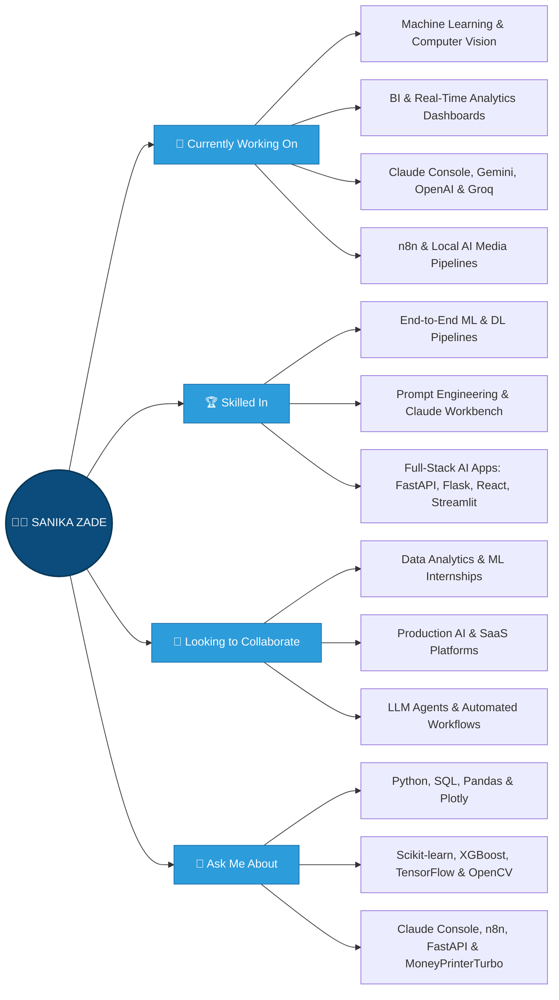

#  Hi there! I'm Sanika Zade

### FINAL-YEAR B.TECH AI/ML STUDENT · DATA ANALYTICS ENTHUSIAST · ASPIRING ML & GENAI ENGINEER

    [GitHub Followers](https://www.google.com/search?q=https://github.com/SanikaZade%3Ftab%3Dfollowers)

---

## 👩‍💻 About Me

> *"I enjoy applying data analytics, machine learning, and generative AI to messy, real-world problems — the harder the dataset, the more interesting the story it tells."* (✿◡‿◡)

---

## 🛠 Tech Stack & Skills

### 💻 Programming Languages

  

### 🤖 AI, Machine Learning, LLMs & Computer Vision

       

### 📊 Data Analytics & Visualization

        

### 🌐 Frontend Development

### ⚙️ Backend & Web Frameworks

   

### 🗄️ Databases

### 🔧 Workflow Automation, AI Media Pipelines & Deployment

    

---

## 🌟 Interactive Live Project Showcase

| Project | Category | Tech Stack | Links |
| :--- | :--- | :--- | :---: |
| **🏢 [BuyerLens Real Estate Intelligence](https://github.com/SanikaZade/BuyerLens-Real-Estate-Segmentation-Intelligence-Dashboard)** | AI Clustering + Claude LLM | `Streamlit` `Scikit-Learn` `Claude Console & API` `Plotly` | [🌐 Live App](https://buyerlens-real-estate-segmentation-intelligence-dashboard-mtev.streamlit.app/) · [💻 Repo](https://github.com/SanikaZade/BuyerLens-Real-Estate-Segmentation-Intelligence-Dashboard) |
| **⛴️ [Toronto Ferry Analytics (10+ Yrs)](https://github.com/SanikaZade/Ferry-Analytics-Project)** | Real-Time BI & KPIs | `Python` `Streamlit` `Pandas` `Plotly` | [🌐 Live App](https://ferry-analytics-project.streamlit.app/) · [💻 Repo](https://github.com/SanikaZade/Ferry-Analytics-Project) |
| **✈️ [TravelLoop AI Travel SaaS](https://github.com/SanikaZade/Traveloop-ai)** | Full-Stack AI SaaS | `React 18` `Tailwind` `Node.js` `Express` `MongoDB` | [🌐 Live App](https://traveloop-ai-mocha.vercel.app/) · [💻 Repo](https://github.com/SanikaZade/Traveloop-ai) |
| **⚡ [AI Application Compiler](https://github.com/SanikaZade/AI-Application-compiler)** | NL-to-Architecture | `FastAPI` `React` `Tailwind` `SQLAlchemy` `Pydantic` | [🌐 Live App](https://ai-application-compiler-two.vercel.app/) · [💻 Repo](https://github.com/SanikaZade/AI-Application-compiler) |
| **🎓 [AI College Recommendation System](https://github.com/SanikaZade/Ai_college_recommendation)** | ML + GPT Counseling | `Flask` `OpenAI API` `SQLite` `Chart.js` `ReportLab` | [🌐 Live App](https://ai-college-recommendation-2.onrender.com) · [💻 Repo](https://github.com/SanikaZade/Ai_college_recommendation) |
| **📦 [Amazon India Sales BI (128k Orders)](https://github.com/SanikaZade/amazon_dashboard_project)** | Interactive BI | `Python` `Pandas` `Plotly.js` `JavaScript` | [🌐 Live App](https://sanikazade.github.io/amazon_dashboard_project/) · [💻 Repo](https://github.com/SanikaZade/amazon_dashboard_project) |
| **🚚 [APL Logistics Profitability (180k Rows)](https://github.com/SanikaZade/APL_Logistics-Business-Intelligence-and-Profitability-Analytics)** | Supply Chain Analytics | `Python` `Streamlit` `Pandas` `NumPy` `Plotly` | [🌐 Live App](https://apllogistics-business-intelligence-and-profitability-analytics.streamlit.app/) · [💻 Repo](https://github.com/SanikaZade/APL_Logistics-Business-Intelligence-and-Profitability-Analytics) |
| **🔗 [AI Smart Supply Chain System](https://github.com/SanikaZade/supply_chain)** | Forecasting + Digital Twin | `Flask` `XGBoost` `Scikit-Learn` `Docker` `Chart.js` | [🌐 Live App](https://supply-chain-sk7y.onrender.com) · [💻 Repo](https://github.com/SanikaZade/supply_chain) |
| **🌱 [EcoSphere ESG Management Platform](https://github.com/SanikaZade/EcoSphere-ESG-Management-Platform)** | Sustainability Analytics | `React 19` `Node.js` `Express` `SQLite` `Recharts` | [🌐 Live App](https://ecosphere-production-cbd7.up.railway.app/) · [💻 Repo](https://github.com/SanikaZade/EcoSphere-ESG-Management-Platform) |
| **🌍 [IoT Carbon Footprint Monitoring](https://github.com/SanikaZade/Corbon-Footprint-Monitoring)** | IoT + Emissions Tracker | `Python` `Streamlit` `IoT Analytics` | [🌐 Live App](https://corbon-footprint-monitoring.streamlit.app/) · [💻 Repo](https://github.com/SanikaZade/Corbon-Footprint-Monitoring) |
| **🏡 [Real Estate Price Trend Analyzer](https://github.com/SanikaZade/Location-Based-Real-Estate-Price-Trend-Analyzer)** | Predictive ML + Maps | `Scikit-Learn` `Pandas` `Google Maps API` `JS` | [🌐 Live Map](https://sanikazade.github.io/Real-Estate/) · [💻 Repo](https://github.com/SanikaZade/Location-Based-Real-Estate-Price-Trend-Analyzer) |

### 🤖 Deep Learning, Computer Vision & n8n AI Automation Projects

- 🚗 **[AI-Powered License Plate Detector](https://github.com/SanikaZade/Ai_powered_license_plate_detector)** — Automatic vehicle license plate localization and OCR using **OpenCV**, **TensorFlow/Keras CNNs**, and **Scikit-Learn**.
- 🧠 **[Student Mental Health Prediction](https://github.com/SanikaZade/Student-Mental-Health)** — Multi-model ML classification benchmark (`RandomForest`, `SVC`, `LogisticRegression`, `KNN`, `GaussianNB`) analyzing student mental health indicators with **Seaborn** & **Matplotlib**.
- 📧 **[n8n Email Support Triage & Auto-Responder](https://github.com/SanikaZade/n8n-Email-Automation-workflow)** — Automated IMAP/SMTP support pipeline powered by **n8n** and **Groq LLM** for ticket logging, intent classification, escalation, and automated drafting.
- 💬 **[Context-Aware AI Chatbot via n8n & Gemini](https://github.com/SanikaZade/AI-chatbot-throught-n8n)** — Conversational AI agent built on **n8n** using **Google Gemini API**, conversation memory, and live **Google Sheets API** tool-calling.
- 📝 **[Automated Question Bank Generator (n8n + Gemini)](https://github.com/SanikaZade/n8n_Question_Generation)** — Extracts educational content from uploaded PDFs and generates multi-difficulty CBSE question banks via **Google Gemini API**.
- 📘 **[Automated CBSE Physics Answer Generator (n8n + Gemini)](https://github.com/SanikaZade/n8n_Answer_Generation)** — Parses NCERT chapter PDFs and generates step-by-step downloadable PDF solutions using **n8n** and **Google Gemini AI**.

### 🧪 Open-Source Forks, Localhost AI Sandboxes & Claude Console Engineering

- 🎬 **[MoneyPrinterTurbo (Forked & Self-Hosted on Localhost)](https://github.com/harry0703/MoneyPrinterTurbo)** — Forked and configured the open-source AI short-video generation pipeline locally (`localhost` Streamlit WebUI & FastAPI server), integrating **LLM script generation**, **Pexels stock footage retrieval**, **Edge/Whisper TTS voiceover synthesis**, automated subtitle alignment, and **MoviePy/FFmpeg** HD video rendering.
- 🧠 **Anthropic Claude Console & Workbench Engineering** — Hands-on prompt engineering, system prompt evaluations, structured JSON output design, and API token/latency optimization in **Claude Console**, powering production buyer-persona insights in **[BuyerLens Real Estate Intelligence](https://github.com/SanikaZade/BuyerLens-Real-Estate-Segmentation-Intelligence-Dashboard)**.

---

## 🎡 Current Focus

- **Expertise:** Building end-to-end AI, Machine Learning, and Full-Stack applications — from exploratory data analysis and model training to production deployment ([FastAPI](https://github.com/SanikaZade/AI-Application-compiler), [Flask](https://github.com/SanikaZade/Ai_college_recommendation), [Streamlit](https://github.com/SanikaZade/BuyerLens-Real-Estate-Segmentation-Intelligence-Dashboard), & [React](https://github.com/SanikaZade/Traveloop-ai))
- **Development:** High-scale Business Intelligence dashboards ([180k+ row APL Logistics](https://github.com/SanikaZade/APL_Logistics-Business-Intelligence-and-Profitability-Analytics), [128k+ order Amazon India BI](https://github.com/SanikaZade/amazon_dashboard_project), [10-year Toronto Ferry Analytics](https://github.com/SanikaZade/Ferry-Analytics-Project)) and Computer Vision pipelines ([CNN License Plate Detector](https://github.com/SanikaZade/Ai_powered_license_plate_detector))
- **Focus:** Generative AI engineering via **Anthropic Claude Console**, [Google Gemini](https://github.com/SanikaZade/AI-chatbot-throught-n8n), [OpenAI](https://github.com/SanikaZade/Ai_college_recommendation), [Groq APIs](https://github.com/SanikaZade/n8n-Email-Automation-workflow), [n8n](https://github.com/SanikaZade/n8n-Email-Automation-workflow) automations, and local open-source AI media pipelines like [MoneyPrinterTurbo](https://github.com/harry0703/MoneyPrinterTurbo)
- **Collaboration:** Actively seeking **Data Analytics, Machine Learning & AI Engineering Internships** and excited to collaborate on impactful real-world AI systems

---

## 📊 GitHub Stats & Analytics

---

## 📈 Contribution Activity Graph

---

## 👀 Profile Views

---

## 🎮 Contribution Animation

> *Turning messy real-world data into useful, actionable insights.* (✿◡‿◡)

---

## 📬 Let's Connect!

**Ready to build the future together? Let's connect and create something amazing!**

   [Instagram](https://www.google.com/search?q=https://www.instagram.com/_sanikazade_)  

