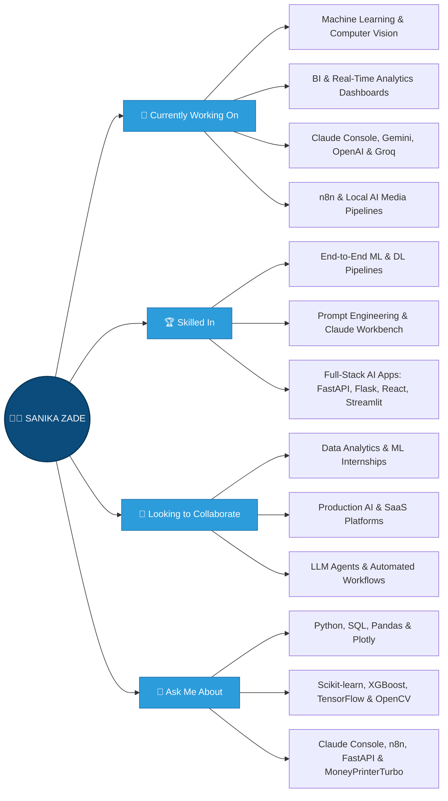

&lt;!-- Animated Wave Banner Header --&gt;
&lt;div align=&quot;center&quot;&gt;

&lt;img src=&quot;https://capsule-render.vercel.app/api?type=waving&amp;color=0:0A0A0A,50:0B4C7C,100:00D4FF&amp;height=180&amp;section=header&amp;text=Sanika%20Zade&amp;fontSize=52&amp;fontColor=ffffff&amp;animation=fadeIn&amp;fontAlignY=35&amp;desc=AI%20%26%20ML%20Engineer%20%7C%20Data%20Analytics%20%7C%20GenAI%20%26%20Full-Stack%20Builder&amp;descAlignY=58&amp;descSize=18&quot; width=&quot;100%&quot; alt=&quot;Header Banner&quot; /&gt;

&lt;h1 align=&quot;center&quot;&gt;
  &lt;img src=&quot;https://media.giphy.com/media/hvRJCLFzcasrR4ia7z/giphy.gif&quot; width=&quot;30px&quot; alt=&quot;Wave&quot; /&gt;
  Hi there! I&#39;m Sanika Zade
&lt;/h1&gt;

&lt;p align=&quot;center&quot;&gt;
  &lt;img src=&quot;https://readme-typing-svg.demolab.com?font=Fira+Code&amp;weight=600&amp;size=22&amp;pause=1200&amp;color=00D4FF&amp;center=true&amp;vCenter=true&amp;width=680&amp;lines=Final-Year+B.Tech+AI%2FML+Student;Data+Analytics+%26+Business+Intelligence+Enthusiast;Machine+Learning+%26+Deep+Learning+Engineer;Building+GenAI+Apps+(Claude+Console+%7C+Gemini+%7C+OpenAI+%7C+n8n);Full-Stack+AI+Developer+(FastAPI+%7C+Flask+%7C+React+%7C+Streamlit);Open+to+AI%2FML+%26+Data+Analytics+Internships&quot; alt=&quot;Typing SVG&quot; /&gt;
&lt;/p&gt;

&lt;h3 align=&quot;center&quot;&gt;
  FINAL-YEAR B.TECH AI/ML STUDENT · DATA ANALYTICS ENTHUSIAST · ASPIRING ML &amp; GENAI ENGINEER
&lt;/h3&gt;

&lt;p align=&quot;center&quot;&gt;
  &lt;img src=&quot;https://media.licdn.com/dms/image/v2/D5612AQHmbpYRanwhfQ/article-cover_image-shrink_720_1280/article-cover_image-shrink_720_1280/0/1735300309639?e=2147483647&amp;v=beta&amp;t=0FkHA6D6JoE5n5-TN487s5WIvc15d29IDfUcYdXnCk0&quot; alt=&quot;Welcome Header Image&quot; width=&quot;100%&quot; /&gt;
&lt;/p&gt;

&lt;p align=&quot;center&quot;&gt;
  &lt;img src=&quot;https://img.shields.io/badge/Open_to-Internships-brightgreen?style=for-the-badge&quot; alt=&quot;Open to internships&quot; /&gt;
  &lt;img src=&quot;https://img.shields.io/badge/Focus-AI%2FML_%7C_Data_Analytics_%7C_GenAI-00D4FF?style=for-the-badge&quot; alt=&quot;Focus areas&quot; /&gt;
  &lt;img src=&quot;https://img.shields.io/badge/Status-Final_Year_B.Tech-orange?style=for-the-badge&quot; alt=&quot;Final-year B.Tech student&quot; /&gt;
  &lt;a href=&quot;https://github.com/SanikaZade&quot;&gt;
    &lt;img src=&quot;https://komarev.com/ghpvc/?username=SanikaZade&amp;label=Profile+Views&amp;color=0e75b6&amp;style=for-the-badge&quot; alt=&quot;Profile views&quot; /&gt;
  &lt;/a&gt;
  &lt;a href=&quot;https://github.com/SanikaZade?tab=followers&quot;&gt;
    &lt;img src=&quot;https://img.shields.io/github/followers/SanikaZade?label=Followers&amp;style=for-the-badge&amp;color=2D9CDB&quot; alt=&quot;GitHub Followers&quot; /&gt;
  &lt;/a&gt;
&lt;/p&gt;

&lt;/div&gt;

---

## &lt;img src=&quot;https://github.com/SP-XD/SP-XD/blob/main/images/message.gif?raw=true&quot; width=&quot;30&quot; alt=&quot;About Me&quot; /&gt; About Me

> *"I enjoy applying data analytics, machine learning, and generative AI to messy, real-world problems — the harder the dataset, the more interesting the story it tells."* (✿◡‿◡)

&lt;div align=&quot;center&quot;&gt;

&lt;/div&gt;

---

## 🛠 Tech Stack & Skills

&lt;div align=&quot;center&quot;&gt;

### 💻 Programming Languages
&lt;img src=&quot;https://techstack-generator.vercel.app/python-icon.svg&quot; width=&quot;60&quot; alt=&quot;Python&quot; /&gt;
&lt;img src=&quot;https://techstack-generator.vercel.app/js-icon.svg&quot; width=&quot;60&quot; alt=&quot;JavaScript&quot; /&gt;
&lt;img src=&quot;https://cdn.jsdelivr.net/gh/devicons/devicon/icons/azuresqldatabase/azuresqldatabase-original.svg&quot; width=&quot;55&quot; alt=&quot;SQL&quot; /&gt;

### 🤖 AI, Machine Learning, LLMs & Computer Vision
&lt;img src=&quot;https://skillicons.dev/icons?i=tensorflow,sklearn,opencv&quot; width=&quot;185&quot; alt=&quot;TensorFlow, Scikit-learn, OpenCV&quot; /&gt;
&lt;img src=&quot;https://cdn.simpleicons.org/keras/D00000&quot; width=&quot;50&quot; alt=&quot;Keras&quot; /&gt;
&lt;img src=&quot;https://cdn.simpleicons.org/scipy/8CAAE6&quot; width=&quot;50&quot; alt=&quot;SciPy&quot; /&gt;
&lt;img src=&quot;https://cdn.jsdelivr.net/npm/simple-icons@latest/icons/openai.svg&quot; width=&quot;48&quot; alt=&quot;OpenAI API&quot; /&gt;
&lt;img src=&quot;https://cdn.simpleicons.org/googlegemini/8E75B2&quot; width=&quot;48&quot; alt=&quot;Google Gemini API&quot; /&gt;
&lt;img src=&quot;https://cdn.simpleicons.org/anthropic/D97757&quot; width=&quot;48&quot; alt=&quot;Anthropic Claude API&quot; /&gt;
&lt;br/&gt;&lt;br/&gt;
&lt;img src=&quot;https://img.shields.io/badge/Anthropic_Claude_Console-D97757?style=for-the-badge&amp;logo=anthropic&amp;logoColor=white&quot; height=&quot;36&quot; alt=&quot;Claude Console&quot; /&gt;
&lt;img src=&quot;https://img.shields.io/badge/Prompt_Engineering-8E75B2?style=for-the-badge&amp;logo=sparkles&amp;logoColor=white&quot; height=&quot;36&quot; alt=&quot;Prompt Engineering&quot; /&gt;
&lt;img src=&quot;https://img.shields.io/badge/XGBoost-158CBA?style=for-the-badge&amp;logo=python&amp;logoColor=white&quot; height=&quot;36&quot; alt=&quot;XGBoost&quot; /&gt;
&lt;img src=&quot;https://img.shields.io/badge/Groq_LLM_API-F55036?style=for-the-badge&amp;logo=lightning&amp;logoColor=white&quot; height=&quot;36&quot; alt=&quot;Groq API&quot; /&gt;

### 📊 Data Analytics & Visualization
&lt;img src=&quot;https://cdn.simpleicons.org/pandas/150458&quot; width=&quot;55&quot; alt=&quot;Pandas&quot; /&gt;
&lt;img src=&quot;https://cdn.simpleicons.org/numpy/013243&quot; width=&quot;55&quot; alt=&quot;NumPy&quot; /&gt;
&lt;img src=&quot;https://cdn.jsdelivr.net/gh/devicons/devicon/icons/plotly/plotly-original-wordmark.svg&quot; width=&quot;55&quot; alt=&quot;Plotly&quot; /&gt;
&lt;img src=&quot;https://cdn.jsdelivr.net/gh/devicons/devicon/icons/matplotlib/matplotlib-original.svg&quot; width=&quot;55&quot; alt=&quot;Matplotlib&quot; /&gt;
&lt;img src=&quot;https://cdn.simpleicons.org/chartdotjs/FF6384&quot; width=&quot;50&quot; alt=&quot;Chart.js&quot; /&gt;
&lt;img src=&quot;https://cdn.jsdelivr.net/gh/devicons/devicon/icons/jupyter/jupyter-original-wordmark.svg&quot; width=&quot;55&quot; alt=&quot;Jupyter&quot; /&gt;
&lt;br/&gt;&lt;br/&gt;
&lt;img src=&quot;https://img.shields.io/badge/Seaborn-3776AB?style=for-the-badge&amp;logo=python&amp;logoColor=white&quot; height=&quot;36&quot; alt=&quot;Seaborn&quot; /&gt;
&lt;img src=&quot;https://img.shields.io/badge/Power_BI-F2C811?style=for-the-badge&amp;logo=powerbi&amp;logoColor=black&quot; height=&quot;36&quot; alt=&quot;Power BI&quot; /&gt;
&lt;img src=&quot;https://img.shields.io/badge/Recharts-22B5BF?style=for-the-badge&amp;logo=react&amp;logoColor=white&quot; height=&quot;36&quot; alt=&quot;Recharts&quot; /&gt;

### 🌐 Frontend Development
&lt;img src=&quot;https://techstack-generator.vercel.app/react-icon.svg&quot; width=&quot;60&quot; alt=&quot;React&quot; /&gt;
&lt;img src=&quot;https://skillicons.dev/icons?i=vite,tailwind,bootstrap,html,css&quot; width=&quot;280&quot; alt=&quot;Vite, Tailwind CSS, Bootstrap, HTML5, CSS3&quot; /&gt;

### ⚙️ Backend & Web Frameworks
&lt;img src=&quot;https://skillicons.dev/icons?i=fastapi,flask,nodejs,express&quot; width=&quot;230&quot; alt=&quot;FastAPI, Flask, Node.js, Express.js&quot; /&gt;
&lt;img src=&quot;https://cdn.simpleicons.org/streamlit/FF4B4B&quot; width=&quot;55&quot; alt=&quot;Streamlit&quot; /&gt;
&lt;img src=&quot;https://cdn.simpleicons.org/sqlalchemy/D71F00&quot; width=&quot;55&quot; alt=&quot;SQLAlchemy&quot; /&gt;
&lt;img src=&quot;https://cdn.simpleicons.org/pydantic/E92063&quot; width=&quot;50&quot; alt=&quot;Pydantic&quot; /&gt;
&lt;img src=&quot;https://cdn.simpleicons.org/gunicorn/499848&quot; width=&quot;50&quot; alt=&quot;Gunicorn&quot; /&gt;

### 🗄️ Databases
&lt;img src=&quot;https://techstack-generator.vercel.app/mysql-icon.svg&quot; width=&quot;75&quot; alt=&quot;MySQL&quot; /&gt;
&lt;img src=&quot;https://skillicons.dev/icons?i=mongodb,sqlite&quot; width=&quot;120&quot; alt=&quot;MongoDB, SQLite&quot; /&gt;
&lt;img src=&quot;https://cdn.simpleicons.org/mongoose/880000&quot; width=&quot;55&quot; alt=&quot;Mongoose&quot; /&gt;

### 🔧 Workflow Automation, AI Media Pipelines & Deployment
&lt;img src=&quot;https://cdn.simpleicons.org/n8n/EA4B71&quot; width=&quot;55&quot; alt=&quot;n8n&quot; /&gt;
&lt;img src=&quot;https://techstack-generator.vercel.app/docker-icon.svg&quot; width=&quot;60&quot; alt=&quot;Docker&quot; /&gt;
&lt;img src=&quot;https://skillicons.dev/icons?i=git,github,vscode,vercel&quot; width=&quot;220&quot; alt=&quot;Git, GitHub, VS Code, Vercel&quot; /&gt;
&lt;img src=&quot;https://cdn.simpleicons.org/render/46E3B7&quot; width=&quot;50&quot; alt=&quot;Render&quot; /&gt;
&lt;img src=&quot;https://cdn.simpleicons.org/railway/FFFFFF&quot; width=&quot;50&quot; alt=&quot;Railway&quot; /&gt;
&lt;img src=&quot;https://cdn.simpleicons.org/ffmpeg/007808&quot; width=&quot;50&quot; alt=&quot;FFmpeg&quot; /&gt;

&lt;/div&gt;

---

## 🌟 Interactive Live Project Showcase

&lt;div align=&quot;center&quot;&gt;

| Project | Category | Tech Stack | Links |
| :--- | :--- | :--- | :---: |
| **🏢 [BuyerLens Real Estate Intelligence](https://github.com/SanikaZade/BuyerLens-Real-Estate-Segmentation-Intelligence-Dashboard)** | AI Clustering + Claude LLM | `Streamlit` `Scikit-Learn` `Claude Console & API` `Plotly` | [🌐 Live App](https://buyerlens-real-estate-segmentation-intelligence-dashboard-mtev.streamlit.app/) · [💻 Repo](https://github.com/SanikaZade/BuyerLens-Real-Estate-Segmentation-Intelligence-Dashboard) |
| **⛴️ [Toronto Ferry Analytics (10+ Yrs)](https://github.com/SanikaZade/Ferry-Analytics-Project)** | Real-Time BI & KPIs | `Python` `Streamlit` `Pandas` `Plotly` | [🌐 Live App](https://ferry-analytics-project.streamlit.app/) · [💻 Repo](https://github.com/SanikaZade/Ferry-Analytics-Project) |
| **✈️ [TravelLoop AI Travel SaaS](https://github.com/SanikaZade/Traveloop-ai)** | Full-Stack AI SaaS | `React 18` `Tailwind` `Node.js` `Express` `MongoDB` | [🌐 Live App](https://traveloop-ai-mocha.vercel.app/) · [💻 Repo](https://github.com/SanikaZade/Traveloop-ai) |
| **⚡ [AI Application Compiler](https://github.com/SanikaZade/AI-Application-compiler)** | NL-to-Architecture | `FastAPI` `React` `Tailwind` `SQLAlchemy` `Pydantic` | [🌐 Live App](https://ai-application-compiler-two.vercel.app/) · [💻 Repo](https://github.com/SanikaZade/AI-Application-compiler) |
| **🎓 [AI College Recommendation System](https://github.com/SanikaZade/Ai_college_recommendation)** | ML + GPT Counseling | `Flask` `OpenAI API` `SQLite` `Chart.js` `ReportLab` | [🌐 Live App](https://ai-college-recommendation-2.onrender.com) · [💻 Repo](https://github.com/SanikaZade/Ai_college_recommendation) |
| **📦 [Amazon India Sales BI (128k Orders)](https://github.com/SanikaZade/amazon_dashboard_project)** | Interactive BI | `Python` `Pandas` `Plotly.js` `JavaScript` | [🌐 Live App](https://sanikazade.github.io/amazon_dashboard_project/) · [💻 Repo](https://github.com/SanikaZade/amazon_dashboard_project) |
| **🚚 [APL Logistics Profitability (180k Rows)](https://github.com/SanikaZade/APL_Logistics-Business-Intelligence-and-Profitability-Analytics)** | Supply Chain Analytics | `Python` `Streamlit` `Pandas` `NumPy` `Plotly` | [🌐 Live App](https://apllogistics-business-intelligence-and-profitability-analytics.streamlit.app/) · [💻 Repo](https://github.com/SanikaZade/APL_Logistics-Business-Intelligence-and-Profitability-Analytics) |
| **🔗 [AI Smart Supply Chain System](https://github.com/SanikaZade/supply_chain)** | Forecasting + Digital Twin | `Flask` `XGBoost` `Scikit-Learn` `Docker` `Chart.js` | [🌐 Live App](https://supply-chain-sk7y.onrender.com) · [💻 Repo](https://github.com/SanikaZade/supply_chain) |
| **🌱 [EcoSphere ESG Management Platform](https://github.com/SanikaZade/EcoSphere-ESG-Management-Platform)** | Sustainability Analytics | `React 19` `Node.js` `Express` `SQLite` `Recharts` | [🌐 Live App](https://ecosphere-production-cbd7.up.railway.app/) · [💻 Repo](https://github.com/SanikaZade/EcoSphere-ESG-Management-Platform) |
| **🌍 [IoT Carbon Footprint Monitoring](https://github.com/SanikaZade/Corbon-Footprint-Monitoring)** | IoT + Emissions Tracker | `Python` `Streamlit` `IoT Analytics` | [🌐 Live App](https://corbon-footprint-monitoring.streamlit.app/) · [💻 Repo](https://github.com/SanikaZade/Corbon-Footprint-Monitoring) |
| **🏡 [Real Estate Price Trend Analyzer](https://github.com/SanikaZade/Location-Based-Real-Estate-Price-Trend-Analyzer)** | Predictive ML + Maps | `Scikit-Learn` `Pandas` `Google Maps API` `JS` | [🌐 Live Map](https://sanikazade.github.io/Real-Estate/) · [💻 Repo](https://github.com/SanikaZade/Location-Based-Real-Estate-Price-Trend-Analyzer) |

&lt;/div&gt;

&lt;details&gt;
&lt;summary&gt;&lt;b&gt;🤖 Click to explore my Deep Learning, Computer Vision &amp; n8n AI Automation Projects&lt;/b&gt;&lt;/summary&gt;
&lt;br/&gt;

- 🚗 **[AI-Powered License Plate Detector](https://github.com/SanikaZade/Ai_powered_license_plate_detector)** — Automatic vehicle license plate localization and OCR using **OpenCV**, **TensorFlow/Keras CNNs**, and **Scikit-Learn**.
- 🧠 **[Student Mental Health Prediction](https://github.com/SanikaZade/Student-Mental-Health)** — Multi-model ML classification benchmark (`RandomForest`, `SVC`, `LogisticRegression`, `KNN`, `GaussianNB`) analyzing student mental health indicators with **Seaborn** & **Matplotlib**.
- 📧 **[n8n Email Support Triage & Auto-Responder](https://github.com/SanikaZade/n8n-Email-Automation-workflow)** — Automated IMAP/SMTP support pipeline powered by **n8n** and **Groq LLM** for ticket logging, intent classification, escalation, and automated drafting.
- 💬 **[Context-Aware AI Chatbot via n8n & Gemini](https://github.com/SanikaZade/AI-chatbot-throught-n8n)** — Conversational AI agent built on **n8n** using **Google Gemini API**, conversation memory, and live **Google Sheets API** tool-calling.
- 📝 **[Automated Question Bank Generator (n8n + Gemini)](https://github.com/SanikaZade/n8n_Question_Generation)** — Extracts educational content from uploaded PDFs and generates multi-difficulty CBSE question banks via **Google Gemini API**.
- 📘 **[Automated CBSE Physics Answer Generator (n8n + Gemini)](https://github.com/SanikaZade/n8n_Answer_Generation)** — Parses NCERT chapter PDFs and generates step-by-step downloadable PDF solutions using **n8n** and **Google Gemini AI**.

&lt;/details&gt;

&lt;details&gt;
&lt;summary&gt;&lt;b&gt;🧪 Click to explore my Open-Source Forks, Localhost AI Sandboxes &amp; Claude Console Experiments&lt;/b&gt;&lt;/summary&gt;
&lt;br/&gt;

- 🎬 **[MoneyPrinterTurbo (Forked & Self-Hosted on Localhost)](https://github.com/harry0703/MoneyPrinterTurbo)** — Forked and configured the open-source AI short-video generation pipeline locally (`localhost` Streamlit WebUI & FastAPI server), integrating **LLM script generation**, **Pexels stock footage retrieval**, **Edge/Whisper TTS voiceover synthesis**, automated subtitle alignment, and **MoviePy/FFmpeg** HD video rendering.
- 🧠 **Anthropic Claude Console & Workbench Engineering** — Hands-on prompt engineering, system prompt evaluations, structured JSON output design, and API token/latency optimization in **Claude Console**, powering production buyer-persona insights in **[BuyerLens Real Estate Intelligence](https://github.com/SanikaZade/BuyerLens-Real-Estate-Segmentation-Intelligence-Dashboard)**.

&lt;/details&gt;

---

## 🎡 Current Focus

- **Expertise:** Building end-to-end AI, Machine Learning, and Full-Stack applications — from exploratory data analysis and model training to production deployment ([FastAPI](https://github.com/SanikaZade/AI-Application-compiler), [Flask](https://github.com/SanikaZade/Ai_college_recommendation), [Streamlit](https://github.com/SanikaZade/BuyerLens-Real-Estate-Segmentation-Intelligence-Dashboard), & [React](https://github.com/SanikaZade/Traveloop-ai))
- **Development:** High-scale Business Intelligence dashboards ([180k+ row APL Logistics](https://github.com/SanikaZade/APL_Logistics-Business-Intelligence-and-Profitability-Analytics), [128k+ order Amazon India BI](https://github.com/SanikaZade/amazon_dashboard_project), [10-year Toronto Ferry Analytics](https://github.com/SanikaZade/Ferry-Analytics-Project)) and Computer Vision pipelines ([CNN License Plate Detector](https://github.com/SanikaZade/Ai_powered_license_plate_detector))
- **Focus:** Generative AI engineering via **Anthropic Claude Console**, [Google Gemini](https://github.com/SanikaZade/AI-chatbot-throught-n8n), [OpenAI](https://github.com/SanikaZade/Ai_college_recommendation), [Groq APIs](https://github.com/SanikaZade/n8n-Email-Automation-workflow), [n8n](https://github.com/SanikaZade/n8n-Email-Automation-workflow) automations, and local open-source AI media pipelines like [MoneyPrinterTurbo](https://github.com/harry0703/MoneyPrinterTurbo)
- **Collaboration:** Actively seeking **Data Analytics, Machine Learning & AI Engineering Internships** and excited to collaborate on impactful real-world AI systems

---

## 📊 GitHub Stats & Analytics

&lt;table&gt;
  &lt;tr&gt;
    &lt;td width=&quot;50%&quot; valign=&quot;top&quot;&gt;
      &lt;img src=&quot;https://github-readme-stats-eight-theta.vercel.app/api?username=SanikaZade&amp;theme=dark&amp;hide_border=false&amp;ring_color=87CEEB&amp;title_color=4B9CD3&amp;text_color=87CEEB&amp;include_all_commits=true&amp;count_private=true&quot;
           width=&quot;100%&quot; style=&quot;display:block; margin:0;&quot; alt=&quot;GitHub Stats&quot;/&gt;
      &lt;br/&gt;
      &lt;img width=&quot;100%&quot; height=&quot;195&quot; src=&quot;https://streak-stats.demolab.com/?user=SanikaZade&amp;theme=dark&amp;hide_border=true&amp;background=0D1117&amp;stroke=0000&amp;ring=00D4FF&amp;fire=00D4FF&amp;currStreakLabel=00D4FF&quot; style=&quot;display:block; margin:0;&quot; alt=&quot;GitHub Streak&quot;/&gt;
      &lt;br/&gt;
      &lt;img src=&quot;https://github-readme-stats-eight-theta.vercel.app/api/top-langs/?username=SanikaZade&amp;theme=dark&amp;hide_border=false&amp;include_all_commits=true&amp;count_private=true&amp;layout=compact&quot;
           width=&quot;100%&quot; style=&quot;display:block; margin:0;&quot; alt=&quot;Top Languages&quot;/&gt;
    &lt;/td&gt;
    &lt;td width=&quot;50%&quot; valign=&quot;center&quot;&gt;
      &lt;img src=&quot;https://user-images.githubusercontent.com/74038190/221352989-518609ab-b4d1-459e-929f-a08cd2bd9b3c.gif&quot; width=&quot;100%&quot; alt=&quot;Programming GIF&quot; /&gt;
    &lt;/td&gt;
  &lt;/tr&gt;
&lt;/table&gt;

&lt;p align=&quot;center&quot;&gt;
  &lt;img src=&quot;https://github-profile-summary-cards.vercel.app/api/cards/profile-details?username=SanikaZade&amp;theme=tokyonight&quot; width=&quot;100%&quot; alt=&quot;GitHub Profile Summary&quot; /&gt;
&lt;/p&gt;

---

## 📈 Contribution Activity Graph

&lt;p align=&quot;center&quot;&gt;
  &lt;a href=&quot;https://github.com/SanikaZade&quot;&gt;
    &lt;img src=&quot;https://github-readme-activity-graph.vercel.app/graph?username=SanikaZade&amp;theme=react-dark&amp;hide_border=true&amp;bg_color=0D1117&amp;color=00D4FF&amp;line=00D4FF&amp;point=FF6B6B&quot; width=&quot;100%&quot; alt=&quot;Sanika&#39;s GitHub Activity Graph&quot; /&gt;
  &lt;/a&gt;
&lt;/p&gt;

---

&lt;h2 align=&quot;center&quot;&gt;👀 Profile Views&lt;/h2&gt;
&lt;div align=&quot;center&quot;&gt;
  &lt;img src=&quot;https://count.getloli.com/@:SanikaZade?theme=booru-twifanartsfw&amp;padding=7&amp;scale=1&amp;align=top&amp;pixelated=1&amp;darkmode=auto&quot; alt=&quot;Profile Views Counter&quot; /&gt;
&lt;/div&gt;

---

## 🎮 Contribution Animation

&lt;div align=&quot;center&quot;&gt;
  &lt;picture&gt;
    &lt;source media=&quot;(prefers-color-scheme: dark)&quot; srcset=&quot;https://raw.githubusercontent.com/platane/snk/output/github-contribution-grid-snake-dark.svg&quot; /&gt;
    &lt;source media=&quot;(prefers-color-scheme: light)&quot; srcset=&quot;https://raw.githubusercontent.com/platane/snk/output/github-contribution-grid-snake.svg&quot; /&gt;
    &lt;img alt=&quot;github contribution grid snake animation&quot; src=&quot;https://raw.githubusercontent.com/platane/snk/output/github-contribution-grid-snake.svg&quot; width=&quot;100%&quot; /&gt;
  &lt;/picture&gt;
&lt;/div&gt;

> *Turning messy real-world data into useful, actionable insights.* (✿◡‿◡)

---

## 📬 Let's Connect!

&lt;div align=&quot;center&quot;&gt;

**Ready to build the future together? Let's connect and create something amazing!**

&lt;a href=&quot;https://www.linkedin.com/in/sanikazade&quot; target=&quot;_blank&quot;&gt;
  &lt;img src=&quot;https://img.shields.io/badge/LinkedIn-0077B5?style=for-the-badge&amp;logo=linkedin&amp;logoColor=white&quot; alt=&quot;LinkedIn&quot; /&gt;
&lt;/a&gt;
&lt;a href=&quot;https://twitter.com/sanikazade&quot; target=&quot;_blank&quot;&gt;
  &lt;img src=&quot;https://img.shields.io/badge/Twitter-1DA1F2?style=for-the-badge&amp;logo=twitter&amp;logoColor=white&quot; alt=&quot;Twitter / X&quot; /&gt;
&lt;/a&gt;
&lt;a href=&quot;https://www.kaggle.com/sanikazade&quot; target=&quot;_blank&quot;&gt;
  &lt;img src=&quot;https://img.shields.io/badge/Kaggle-20BEFF?style=for-the-badge&amp;logo=kaggle&amp;logoColor=white&quot; alt=&quot;Kaggle&quot; /&gt;
&lt;/a&gt;
&lt;a href=&quot;https://www.instagram.com/_sanikazade_&quot; target=&quot;_blank&quot;&gt;
  &lt;img src=&quot;https://img.shields.io/badge/Instagram-fe4164?style=for-the-badge&amp;logo=instagram&amp;logoColor=white&quot; alt=&quot;Instagram&quot; /&gt;
&lt;/a&gt;
&lt;a href=&quot;https://drive.google.com/file/d/1Z-Gbphrn2o7cuJeuz9E9NjIgqtFWFREC/view?usp=sharing&quot; target=&quot;_blank&quot;&gt;
  &lt;img src=&quot;https://img.shields.io/badge/Resume-4285F4?style=for-the-badge&amp;logo=googledrive&amp;logoColor=white&quot; alt=&quot;View Resume&quot; /&gt;
&lt;/a&gt;
&lt;a href=&quot;https://github.com/SanikaZade&quot; target=&quot;_blank&quot;&gt;
  &lt;img src=&quot;https://img.shields.io/badge/GitHub-181717?style=for-the-badge&amp;logo=github&amp;logoColor=white&quot; alt=&quot;GitHub&quot; /&gt;
&lt;/a&gt;

&lt;/div&gt;

&lt;p align=&quot;center&quot;&gt;
  &lt;img src=&quot;https://capsule-render.vercel.app/api?type=waving&amp;color=0:00D4FF,100:0A0A0A&amp;height=100&amp;section=footer&quot; width=&quot;100%&quot; alt=&quot;Footer Wave&quot; /&gt;
&lt;/p&gt;